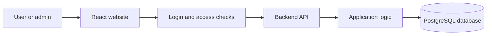
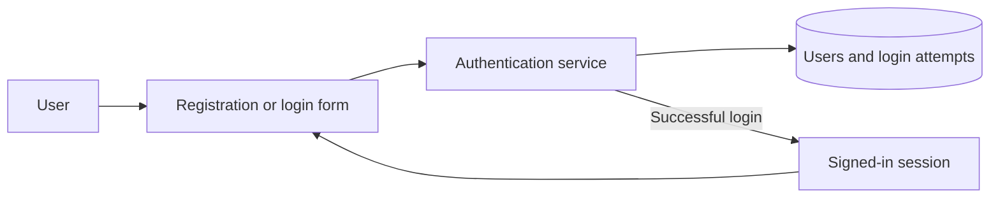
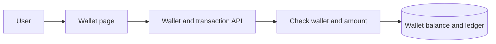
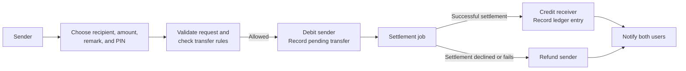
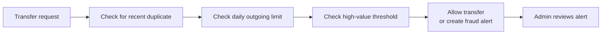
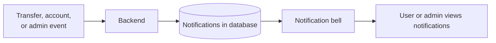
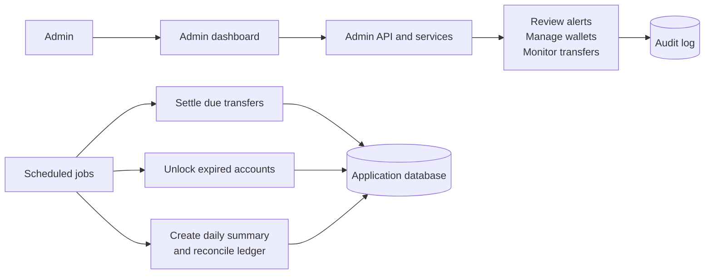

# P2P Payment Ledger — Architecture

A simple overview of the main parts of the application and how they work
together.

## 1. Application structure

The website sends requests to the backend. The backend checks access, applies
the application rules, and reads or saves data in the database.

## 2. Registration and login

Registration creates the user and their wallet. At login, the backend checks
the password and tracks failed attempts. A successful login starts an
authenticated session.

## 3. Wallet

Users can view their balance and deposit or withdraw simulated funds. Wallet
status determines whether money operations are allowed.

## 4. Sending and settling a transfer

The sender's money is held as a pending transfer until settlement. The receiver
is credited after settlement; if settlement cannot complete, the sender is
refunded.

## 5. Fraud checks

The backend checks transfers before processing them. A high-value transfer can
proceed while being flagged for admin review; blocked checks reject the
transfer.

## 6. Notifications

Notifications are stored in the database and shown in the app, where users can
see unread notifications and mark them as read.

## 7. Admin and background jobs

Admins use the dashboard to monitor the ledger and take administrative
actions. Background jobs handle settlement, account unlocks, and daily
summaries automatically.
